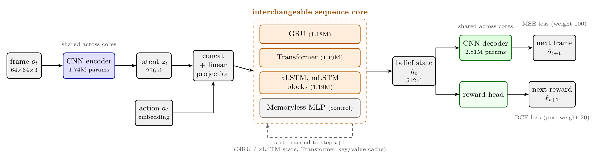
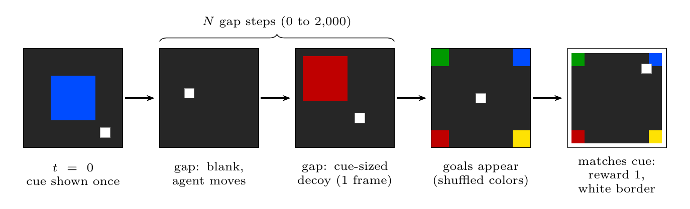

# Memory in Action-Conditioned World Models

A controlled comparison of **GRU**, **causal Transformer** and **xLSTM** (mLSTM) cores on a cue-recall task, at matched size (~1.2M parameters in the core, ~5.9M in total) on a single 8 GB GPU.

*A shared CNN encoder and decoder surround an interchangeable sequence core. Only the core changes between models.*

## Idea

Robots act on partial observations and must remember. Inside a learned world model, which sequence core keeps the most useful belief state over long horizons, per parameter and per unit of VRAM?

**Task.** On an 8×8 grid rendered as 64×64 frames, a colored cue is shown once, hidden for `N` blank steps (0 to 2,000), and then four shuffled goals appear. The agent must reach the goal that matches the cue. Optional distractors (small dots or cue-sized decoy blocks) appear during the gap.

**Environment.**

*Schematic of the 64×64 frames: the cue is shown at t=0, followed by N gap steps (optionally with decoys), then four shuffled goals; reaching the matching goal gives reward 1.*

## Hypotheses

| | Hypothesis |
|---|---|
| H1 | xLSTM keeps cue recall over longer gaps than a GRU of equal size |
| H2 | GRU and xLSTM use constant memory in context length; the Transformer's grows |
| H3 | Recurrent cores trained on short contexts extrapolate better than the Transformer |
| H4 | Better belief states give higher goal-reaching success when planning by imagination |

## Experiments

- **Memory:** AUC of the final-step reward prediction per gap length, with memoryless negative and visible-cue positive controls.
- **Interference:** no distractors, small dots, cue-sized decoys.
- **Planning (E3):** imagine four walk-to-goal plans from the belief state and execute the best one.
- **Efficiency (E4):** state size, peak VRAM and latency versus context length.
- **Training:** direct training failed, so all cores use a 3-stage warm start (visible cue, then gaps 0/2, then gaps 10 to 60 with decoys).

## Current state

One training seed per configuration, so treat results as indicative.

| Finding | Result |
|---|---|
| Direct training | No core learned from the sparse end-of-episode reward; the staged recipe was needed |
| Inside trained range (gap ≤ 60) | Transformer AUC ≈ 1.0; GRU and xLSTM ≈ 0.83 |
| Beyond trained range (gap 100 to 500) | GRU stays ≈ 0.83; Transformer and final xLSTM checkpoint fall to chance |
| Planning | Follows the AUC curves (GRU ≈ 55%, Transformer 100% in range then 28 to 43%) |
| Efficiency | GRU and xLSTM state is constant; Transformer runs out of memory at 256 rollouts between 4,096 and 8,192 steps |
| Hypotheses | H1 not supported, H2 supported (one-step mode), H3 partly supported, H4 consistent |

**Next:** 3+ seeds per core, Theorical investigations of the results, experiment with other environments and other tasks.

## Author

Moheb Abdelhafidh · mouhebabdelhafidh20@gmail.com
